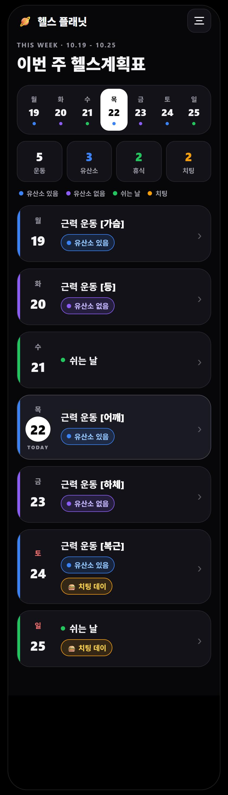
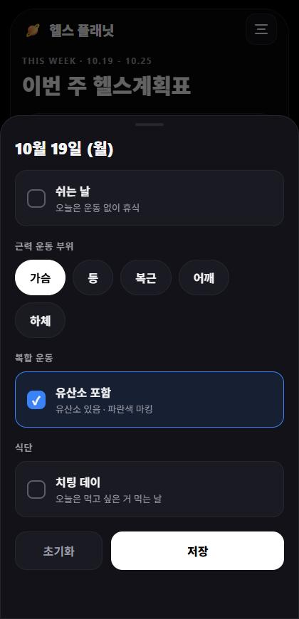
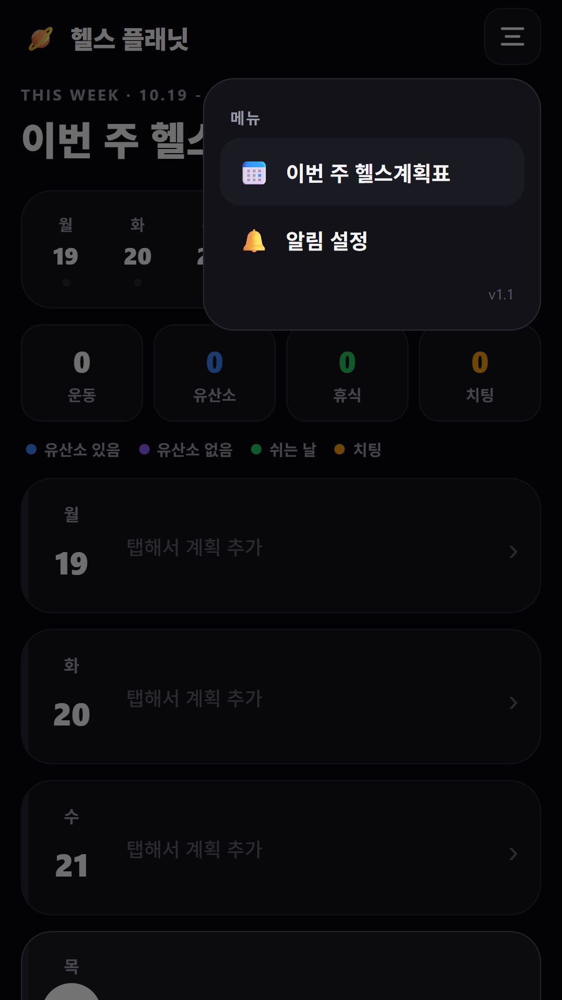
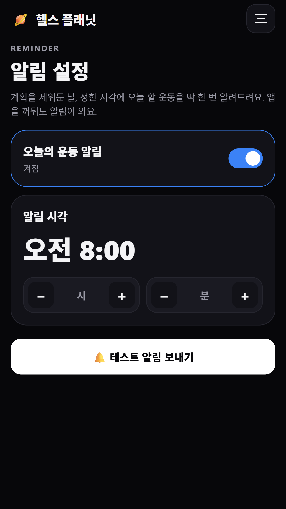

# 헬스 플래닛 (Health Planet)

이 앱은 헬스장에서 주마다 어떤 부위 운동과 치팅데이, 쉬는 날, 유산소와 같은 복합 운동을 기록하는 계획표 어플입니다.


## v1.0 기능
- 메인: 이번 주(월~일) 7일 큼지막한 주간 달력, 오늘 날짜 강조
- 요일별 근력 운동 부위 선택: 가슴 / 등 / 복근 / 어깨 / 하체 (복수 선택 가능)
- 복합 운동(유산소) 체크
  - 체크 → `근력 운동 [어깨]` + **유산소 있음** (파란색 마킹)
  - 미체크 → `근력 운동 [어깨]` + **유산소 없음** (보라색 마킹)
- 쉬는 날 체크 (초록색), 치팅 데이 체크 (주황색)
- 데이터는 기기 내부(AsyncStorage)에만 저장

## v1.1 기능
- 오늘의 운동 알림: 계획을 세워둔 날, 정한 시각(기본 오전 8:00)에 오늘 할 운동을 하루 한 번 알림
  - 앱이 백그라운드에 있거나 꺼져 있어도 시스템 예약 알림으로 도착 (재부팅 후에도 유지)
  - 메뉴 › 알림 설정에서 켜기/끄기, 시각 변경, 테스트 알림

## 미리보기
| 주간 계획표 | 편집 | 메뉴 |
| --- | --- | --- |
|  |  |  |

| 알림 설정 |
| --- |
|  |

## 개발
```bash
npm install
npm start          # Metro
npm run android    # 기기/에뮬레이터 실행
npm test
```

앱 아이콘은 `assets/store/icon-generator.js`(SVG → PNG)로 생성했습니다.
